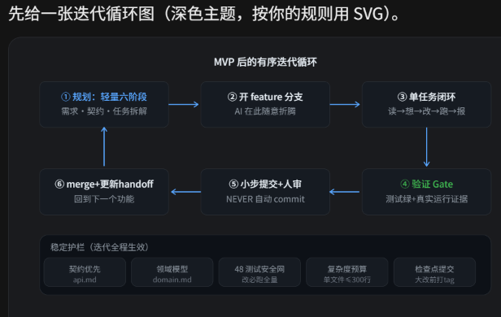

# 迭代纪律手册

> 本手册对应 vibe-coding 实战手册第 **18.2** 节：把原子 Task 交给 Cursor / Trae 的纪律。  
> 适用于将 `docs/tasks.md` 中的原子任务交给外部 AI 编码工具（Cursor、Trae、Windsurf 等）执行的场景。

## 流程总览


## 核心原则

原子任务 + 契约前置 + 范围锁定 + 验证 Gate + 人审终审 + 分支隔离。

## 给 AI 编码工具的 prompt 模板

```text
任务：<从 tasks.md 复制这一个 task 的 目标+验收标准+依赖>
范围限制：只做本 task，不夹带任何额外重构 / 优化 / 新功能
契约前置：先读本仓库 docs/api.md 和 docs/domain.md；动接口先改这两份，再改实现
上下文：本仓库是 Spring Boot 3.3.5 + Java 17(编译) / JDK 21(构建)，用 .\mvnw.cmd 构建，NEVER 用 Git Bash 跑 mvn
验证 Gate：改完必须跑 .\mvnw.cmd test 全绿，并告诉我哪条测试覆盖了本改动；不许只口头说"改好了"
提交：不要自动 commit，改完等我校 diff
```

## 六条纪律

1. **一次只喂一个原子 task**  
   不要把整个 R1 丢进去，AI 会自作主张扩大改动面。

2. **契约前置必须写进 prompt**  
   把 `docs/api.md` / `docs/domain.md` 路径给它，要求"动接口先改文档"。

3. **验证 Gate 不可跳过**  
   要求它跑 `mvnw test` 并报告；但你（人）必须亲自复核，AI 说绿不等于真绿。

4. **feature 分支隔离**  
   每个工具会话开自己的分支，跑偏了直接丢分支，主分支不脏。

5. **不要多工具并行改同一文件**  
   Cursor 改 A、Trae 改 A 会冲突；按文件 / task 分工。

6. **失败处理**  
   丢 feature 分支，回 `tasks.md` 重选一个 task，不要在原分支上硬修。

## 附录：MVP 后的有序迭代循环



---

## AI 编码工具产出后的人审清单（防错误堆积）

Trea / Cursor 改完一个 task 后，按以下顺序检查。**任何一步不过，都不要推进下一个 task**。

### 1. 先看分支与提交范围

```bash
git status --short
git log --oneline -5
git diff master..feature/xxx --stat
```

- 确认只改了本 task 该改的文件。
- 警惕「顺手重构」：如果 diff 里出现无关文件的大规模改动，立刻叫停。

### 2. 对照 `docs/tasks.md` 验收标准逐条过

- 打开该 task 的「验收」。
- 每条验收必须有测试或真实运行证据覆盖，不能只有代码看起来对。

### 3. 跑全量测试

```powershell
.\mvnw.cmd test
```

- **必须全绿**，不能只跑新加的测试。
- 记录：`Tests run: X, Failures: 0, Errors: 0, Skipped: Y`。

### 4. 真实启动冒烟

```powershell
# 默认 H2（最快）
.\mvnw.cmd spring-boot:run

# 或真库形态
# docker compose up -d
# $env:SPRING_PROFILES_ACTIVE="mysql"; .\mvnw.cmd spring-boot:run
```

- `GET /api/health/deps` → database / redis ok。
- 挑本 task 涉及的 1-2 个关键接口用 curl / 浏览器手动验。

### 5. 审 diff 的重点

- **新增实体 / 字段**：有没有加索引？外键是否合理？`user_id` 隔离是否到位？
- **安全**：密码是否 BCrypt？JWT 密钥是否可配置且 ≥32 字节？有没有把 key 写进 git？
- **日志**：有没有打印 token / 密码 / key？
- **并发**：额度、计数等是否有竞态？
- **异常**：失败是降级还是 500？

### 6. 审文档同步

- `docs/api.md` 和 `docs/domain.md` 是否跟代码一致？
- 如果改了契约但文档没改，要求补文档。

### 7. 发现问题怎么办

- **小问题**：在 feature 分支上修，修完重跑 3-6 步。
- **大问题 / 改动方向跑偏**：直接丢 feature 分支，回 `tasks.md` 重开任务。
- **绝不带着已知 bug 进下一个 task**：这是错误越堆越多的根源。

### 8. 合并与回写

- 只有你确认全部通过，才允许把 feature 分支 merge 到 `main`。
- merge 后更新 `docs/handoff.md` 和 `docs/tasks.md` 状态。
- 再回答 Trea「可以推进下一个 task 了」。

> **R1-1 本次实测样例**：`feature/R1-1` 分支，3 个 commits，全量 `mvnw test` **59 tests, 0 failures, 0 errors, 0 skipped**，`BUILD SUCCESS`。但 JWT 密钥、用户隔离边界、前端 SSE 的 `?jwt=` 参数仍需你在真机 / 浏览器下复核。
