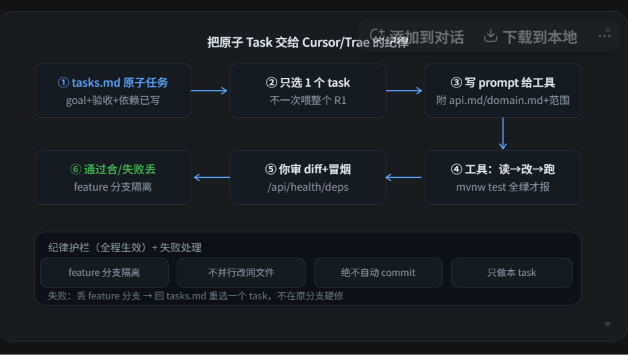

# 迭代纪律手册

> 本手册对应 vibe-coding 实战手册第 **18.2** 节：把原子 Task 交给 Cursor / Trae 的纪律。  
> 适用于将 `docs/tasks.md` 中的原子任务交给外部 AI 编码工具（Cursor、Trae、Windsurf 等）执行的场景。

## 流程总览



## 核心原则

原子任务 + 契约前置 + 范围锁定 + 验证 Gate + 人审终审 + 分支隔离。

## 给 AI 编码工具的 prompt 模板

```text
任务：<从 tasks.md 复制这一个 task 的 目标+验收标准+依赖>
范围限制：只做本 task，不夹带任何额外重构 / 优化 / 新功能
契约前置：先读本仓库 docs/api.md 和 docs/domain.md；动接口先改这两份，再改实现
上下文：本仓库是 Spring Boot 3.3.5 + Java 17(编译) / JDK 21(构建)，用 .\mvnw.cmd 构建，NEVER 用 Git Bash 跑 mvn
验证 Gate：改完必须跑 .\mvnw.cmd test 全绿，并告诉我哪条测试覆盖了本改动；不许只口头说"改好了"
提交：不要自动 commit，改完等我校 diff
```

## 六条纪律

1. **一次只喂一个原子 task**  
   不要把整个 R1 丢进去，AI 会自作主张扩大改动面。

2. **契约前置必须写进 prompt**  
   把 `docs/api.md` / `docs/domain.md` 路径给它，要求"动接口先改文档"。

3. **验证 Gate 不可跳过**  
   要求它跑 `mvnw test` 并报告；但你（人）必须亲自复核，AI 说绿不等于真绿。

4. **feature 分支隔离**  
   每个工具会话开自己的分支，跑偏了直接丢分支，主分支不脏。

5. **不要多工具并行改同一文件**  
   Cursor 改 A、Trae 改 A 会冲突；按文件 / task 分工。

6. **失败处理**  
   丢 feature 分支，回 `tasks.md` 重选一个 task，不要在原分支上硬修。

## 附录：MVP 后的有序迭代循环


